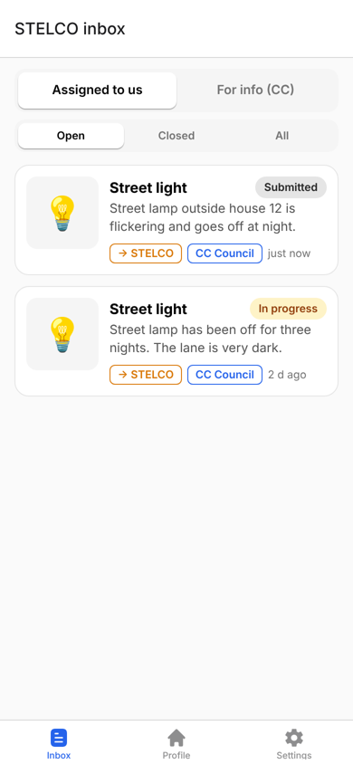
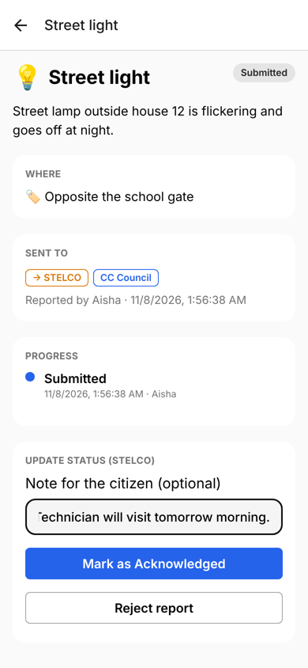
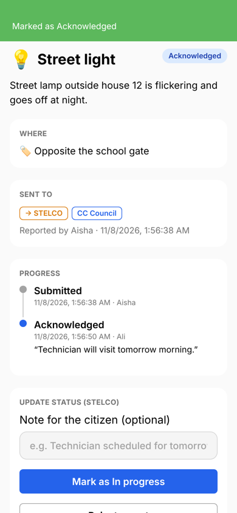
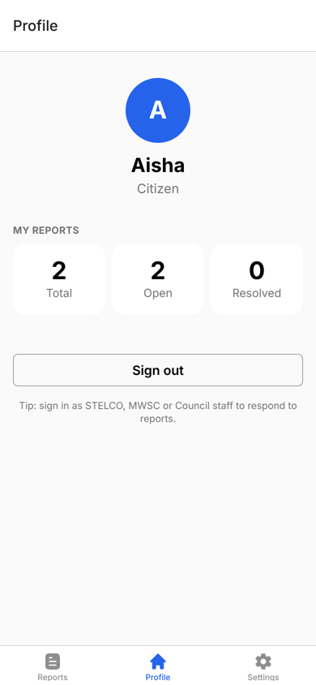
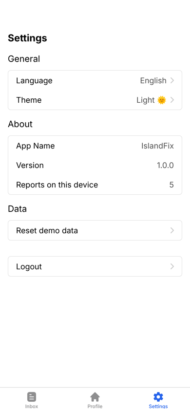

# IslandFix: Civic Issue Reporting App

IslandFix lets residents of a small island report local problems, such as a broken
street light, a water leak or overflowing sewage, straight from their phone.
Each report is **automatically routed to the agency responsible** for fixing it:

| Problem | Sent to | Copied in (for information) |
|---|---|---|
| Street light, power / wires | **STELCO** (electricity) | Island Council |
| Water leak, sewage / drains | **MWSC** (water & sewerage) | Island Council |
| No water supply | **MWSC** | none |
| Roads, waste, public spaces, other | **Island Council** | none |

Staff from each agency sign in to see an **inbox** of reports assigned to them,
update the status (Acknowledged → In progress → Resolved, or Rejected) and leave
notes that the citizen sees on a progress timeline.

The island, agencies and reports are a hypothetical scenario built for the
Mobile Applications module (UFCF7H-15-3). The app runs fully **offline**. All
data is stored on the device.

---

## Installation & Run Instructions

### Requirements
- **Node.js 20 or 22 LTS** and **Yarn 1.x** (`npm install -g yarn`)
- **Expo Go for SDK 53** on your phone. The Play Store / App Store version may
  be newer. On Android, install the SDK 53 build from <https://expo.dev/go>.
  On a Mac, the iOS Simulator (Xcode) installs the right version automatically.
- Phone and computer on the same Wi-Fi network

### Run
```bash
git clone <this-repository-url>
cd <repository-folder>
yarn install
yarn start
```
Then scan the QR code with **Expo Go** (Android) or the Camera app (iOS).

Other commands:

| Command | What it does |
|---|---|
| `yarn ios` / `yarn android` | Open in iOS Simulator / Android emulator |
| `yarn web` | Run in a web browser |
| `yarn test` | Run the unit tests (Jest) |
| `yarn typecheck` | TypeScript type check |
| `yarn lint` | ESLint + Prettier check |
| `npx expo start --tunnel` | Use if your Wi-Fi blocks phone ↔ computer connections |

### Trying it out
1. Tap **Get started** and sign in as a **Citizen** (any name, no password).
2. Tap **+ Report a problem**, pick *Street light*, describe it, optionally add a
   photo and your location, then **Send report**.
3. Go to **Profile → Sign out**, sign in again as **STELCO** staff, open the
   report from the inbox and mark it **Acknowledged** with a note.
4. Sign back in as the citizen with the same name to see the updated timeline.

Sample reports are added on first launch. **Settings → Reset demo data** restores them.

---

## Feature List

| Feature | Description |
|---|---|
| **Role-based sign in** | Choose Citizen, Island Council, STELCO or MWSC. The tabs, lists and allowed actions change by role. |
| **Report a problem** | Category grid, description and landmark with validation (React Hook Form + Zod), optional photo (camera or gallery) and GPS location. |
| **Automatic routing** | The app picks the lead agency and copied agencies from the category and previews it *before* sending ("This will be sent to STELCO, with a copy to Council"). |
| **Address lookup (public API)** | GPS coordinates are turned into a readable address using the free **OpenStreetMap Nominatim** API, with loading, timeout and offline error states. The report still saves without it. |
| **Citizen lists** | *My reports* and *Community* (everything on the island), filtered by Open / Closed / All. |
| **Agency inbox** | *Assigned to us* (agency must act) and *For info (CC)* (agency is copied in, read only). |
| **Status workflow** | Lead agency staff move reports through Submitted → Acknowledged → In progress → Resolved, or Reject them (with confirmation). Invalid jumps are blocked. |
| **Progress timeline** | Every status change is recorded with who made it, when, and an optional note. |
| **Withdraw report** | Citizens can delete their own report while it is still *Submitted* (with confirmation). |
| **Offline persistence** | Reports, the signed-in user, theme and language are saved with AsyncStorage and survive app restarts. Photos are copied into the app's permanent storage. |
| **Profile** | User details and counts of total / open / resolved reports. |
| **Settings** | Light / dark / system theme, language, reports count, reset demo data, sign out. |
| **Accessibility** | Large touch targets (≥ 48 px), screen-reader labels and roles on cards, chips and tabs, colour-coded status badges that also include text. |

---

## Screenshots

| Onboarding | Sign in (choose role) | Community reports |
|---|---|---|
|  |  |  |

| New report (validation) | New report (routing preview) | Report details |
|---|---|---|
|  |  |  |

| STELCO inbox | Staff status update | Timeline after update |
|---|---|---|
|  |  |  |

| Profile | Settings |
|---|---|
|  |  |

> Replace these with screenshots from your phone / simulator if you prefer.

### Navigation flow
```
Onboarding (first launch only)
   └─► Sign in (choose role)
          └─► Bottom tabs
                ├─ Reports / Inbox ──► Report details ──► (staff) update status
                │        └─────────► New report (modal) ──► Report details
                ├─ Profile ──► Sign out ──► Sign in
                └─ Settings (theme, language, reset data, logout)
```
Navigation uses **Expo Router** (file-based): a root **stack**, a **tab** navigator
for signed-in users, a **modal** for the new-report form, and redirect guards for
onboarding and sign in.

---

## Technologies Used

| Area | Technology |
|---|---|
| Framework | React Native 0.79, Expo SDK 53, TypeScript |
| Navigation | Expo Router 5 (stack, tabs, modal) |
| State management | MobX + mobx-react-lite (stores in `src/stores`) |
| Persistence | mobx-persist-store + AsyncStorage, expo-file-system for photos |
| Forms & validation | React Hook Form + Zod |
| Styling | NativeWind (Tailwind CSS for React Native), light/dark themes |
| Device features | expo-image-picker (camera/gallery), expo-location (GPS) |
| Public API | OpenStreetMap Nominatim reverse geocoding (no key needed) |
| Feedback | react-native-flash-message |
| Testing | Jest + jest-expo |
| Starter template | [RN-ExpoGo-Villa-Sample](https://github.com/Yasir5247/RN-ExpoGo-Villa-Sample) |

---

## Project Structure

```
src/
├── app/                       # Screens (file-based routing)
│   ├── _layout.tsx            # Root stack + loading saved data
│   ├── (auth)/onboarding.tsx  # First-launch intro
│   ├── (auth)/login.tsx       # Role-based sign in
│   ├── (app)/_layout.tsx      # Bottom tabs + auth guards
│   ├── (app)/index.tsx        # Reports list / agency inbox
│   ├── (app)/profile.tsx
│   ├── (app)/settings.tsx
│   ├── report/new.tsx         # New report form (modal)
│   └── report/[id].tsx        # Report details, timeline, staff actions
├── components/
│   ├── reports/               # ReportCard, badges, segmented control, etc.
│   └── ui/                    # Base UI kit from the template
├── lib/reports/
│   ├── config.ts              # Agencies, categories, ROUTING RULES
│   ├── logic.ts               # Pure business logic (tested)
│   ├── geocode.ts             # Nominatim API call + error handling
│   ├── media.ts               # Camera, gallery, GPS helpers
│   └── __tests__/             # Unit tests
└── stores/
    ├── auth-store.ts          # Signed-in user + role (persisted)
    ├── reports-store.ts       # All reports (persisted)
    ├── seed-reports.ts        # Demo data
    └── __tests__/
```

---

## Testing & Error Handling

- **26 unit tests** (`yarn test`) cover routing rules, status transitions,
  permissions, list filtering, sorting, helpers and the reports store.
- **Form validation:** inline messages for missing category or a too-short
  description, and for the sign-in name.
- **Permissions:** friendly messages if camera, photo or location access is denied.
- **Network:** address lookup has a timeout and separate messages for offline,
  server errors and "no address found". The report still saves with coordinates.
- **Confirmations** before rejecting or withdrawing a report.
- Tested on Android (Expo Go), iOS Simulator and web.

---

## Known Issues & Future Improvements

- **Single device only:** there is no backend, so reports are not shared between
  phones. Roles are demonstrated by signing out and in on the same device. A
  backend (e.g. Supabase or Firebase) would allow real multi-user use and
  push notifications.
- **No real authentication:** sign in is a demo (name + role, no password).
- **Map view:** reports show an "Open in Maps" link; an in-app map of nearby
  reports would help staff.
- **Translations:** new screens are in English only; full Dhivehi (RTL)
  translation is planned.
- Nominatim is a free community service with rate limits; a production app
  should use its own geocoding provider.

---

## Reflection

*(Write this section in your own words: what went well, what was difficult,
what you learned about React Native / Expo, and what you would do differently.
Link to findings from your user testing report.)*
