# IslandFix: Civic Issue Reporting App


IslandFix is a React Native (Expo) app that lets residents of a small island
report local problems, such as a broken street light, a water leak or
overflowing sewage, from their phone. Each report is **automatically routed to
the agency responsible for fixing it**, and other agencies are copied in so
they stay informed.

| Problem | Sent to (lead agency) | Copied in (for information) |
|---|---|---|
| Street light, power / wires | **STELCO** (electricity) | Island Council |
| Water leak, sewage / drains | **MWSC** (water and sewerage) | Island Council |
| No water supply | **MWSC** | none |
| Roads, waste, public spaces, other | **Island Council** | none |

Agency staff sign in to an **inbox** of reports assigned to them, move each one
through a status workflow (Submitted, Acknowledged, In progress, Resolved or
Rejected) and add notes that the citizen sees on a progress timeline.

The island, agencies and people in this app are a hypothetical scenario created
for the Mobile Applications module (UFCF7H-15-3). The app works fully
**offline**: all data is stored on the device.

---

## Installation and Run Instructions

### Requirements
- **Node.js 20 or 22 LTS** and **Yarn 1.x** (`npm install -g yarn`)
- **Expo Go for SDK 53** on a phone. The app store version of Expo Go may be
  newer than SDK 53. On Android, install the SDK 53 build from
  <https://expo.dev/go>. The iOS Simulator (Xcode) installs the correct version
  automatically.
- Phone and computer on the same Wi-Fi network

### Run
```bash
git clone https://github.com/iTakada012/IslandFix.git
cd IslandFix
yarn install
yarn start
```
Scan the QR code with **Expo Go** (Android) or the Camera app (iOS).

| Command | What it does |
|---|---|
| `yarn start` | Start the development server |
| `yarn ios` / `yarn android` | Open in the iOS Simulator / Android emulator |
| `yarn web` | Run in a web browser |
| `yarn test` | Run the unit tests (Jest) |
| `yarn typecheck` | TypeScript type check |
| `yarn lint` | ESLint and Prettier check |
| `npx expo start --tunnel` | Use when the Wi-Fi blocks phone-to-computer connections |
| `npx expo start --clear` | Restart with a clean cache (after changing config or assets) |

### Demo accounts
Sign in with any of these accounts, or tap one on the sign-in screen to fill
it in automatically.

| Name | Role | Email | Password |
|---|---|---|---|
| Aisha | Citizen | `aisha@islandfix.mv` | `citizen123` |
| Ibrahim | Citizen | `ibrahim@islandfix.mv` | `citizen123` |
| Sara | Island Council staff | `council@islandfix.mv` | `staff123` |
| Ali | STELCO staff | `stelco@islandfix.mv` | `staff123` |
| Hawwa | MWSC staff | `mwsc@islandfix.mv` | `staff123` |

### Suggested walkthrough
1. Tap **Get started** and sign in as **Aisha** (citizen).
2. Tap **Report a problem**, choose *Street light*, add a description and,
   optionally, a photo and your location. The app shows who will receive the
   report before you send it.
3. Go to **Profile > Sign out** and sign in as **Ali** (STELCO).
4. Open the report from the inbox, add a note and tap **Mark as Acknowledged**.
5. Sign back in as Aisha to see the updated progress timeline.

Sample reports are added on first launch. **Settings > Reset demo data**
restores them and **Settings > Delete all reports** empties the app.

---

## Feature List

| Feature | Description |
|---|---|
| **Email and password sign in** | Demo accounts for citizens and for each agency. Wrong details show "Incorrect email or password". The session is remembered after the app is closed. |
| **Role-based app** | Citizens and staff see different tabs, lists and actions. Staff can only update reports their agency leads on. |
| **Report a problem** | Category grid, description and optional landmark, validated with React Hook Form and Zod. Optional photo from the camera or gallery and optional GPS location. |
| **Automatic routing** | The category decides the lead agency and copied agencies. The form previews this before sending ("This will be sent to STELCO, with a copy to Island Council"). |
| **Address lookup (public API)** | GPS coordinates are turned into a readable address with the free **OpenStreetMap Nominatim** API, with loading, timeout and offline error messages. The report still saves without an address. |
| **Citizen lists** | *My reports* and *Community* (everything reported on the island), filtered by Open, Closed or All. |
| **Agency inbox** | *Assigned to us* (the agency must act) and *For info (CC)* (read only). |
| **Status workflow** | Submitted, Acknowledged, In progress, Resolved, with Reject available before a report is resolved (with confirmation). Invalid status jumps are blocked. |
| **Progress timeline** | Every status change is recorded with who made it, when, and an optional note for the citizen. |
| **Withdraw report** | Citizens can delete their own report while it is still Submitted (with confirmation). |
| **Offline persistence** | Reports, the signed-in user and the theme are saved with AsyncStorage and survive restarts. Photos are copied into the app's permanent storage. |
| **Profile** | User details and counts of total, open and resolved reports. |
| **Settings** | Light, dark or system theme; app information; reset demo data; delete all reports; sign out. |
| **Dark mode** | Every screen supports light and dark themes, and the chosen theme is restored on startup. |
| **Icons and branding** | Vector icons (MaterialCommunityIcons) colour-coded by agency, plus a custom app icon, Android adaptive icon and splash screen. |
| **Accessibility** | Large touch targets, screen-reader labels and roles on buttons, cards, chips and tabs, and status badges that use text as well as colour. |

---

## Screenshots

| Onboarding | Sign in | My reports |
|---|---|---|
| 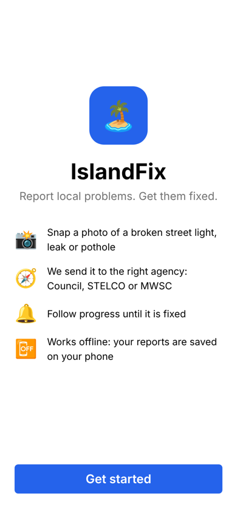 | 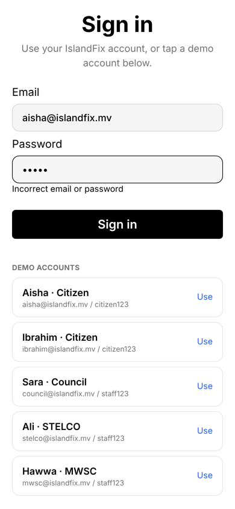 | 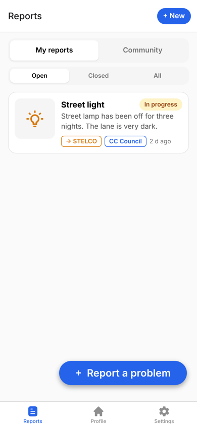 |

| Community reports | New report (validation) | New report (routing preview) |
|---|---|---|
| 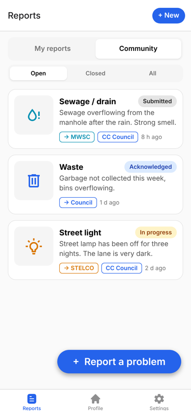 | 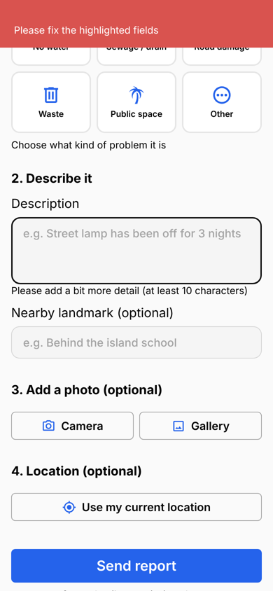 | 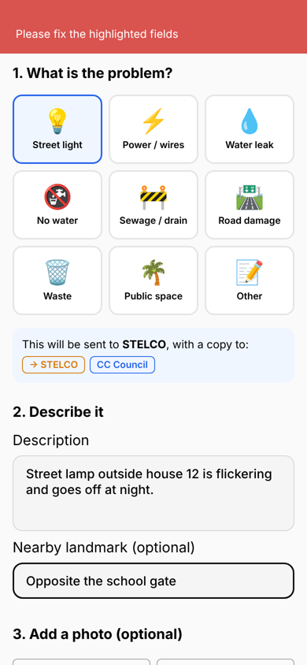 |

| Report details (citizen) | Profile | STELCO inbox |
|---|---|---|
| 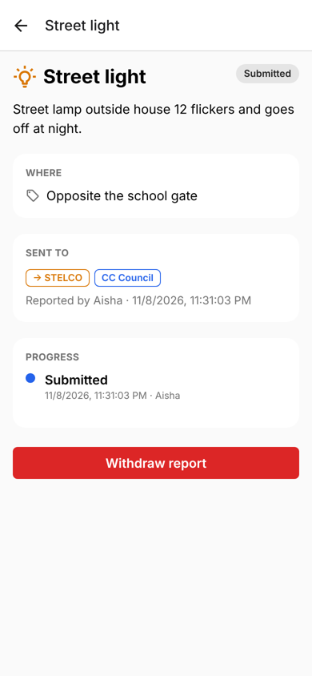 |  | 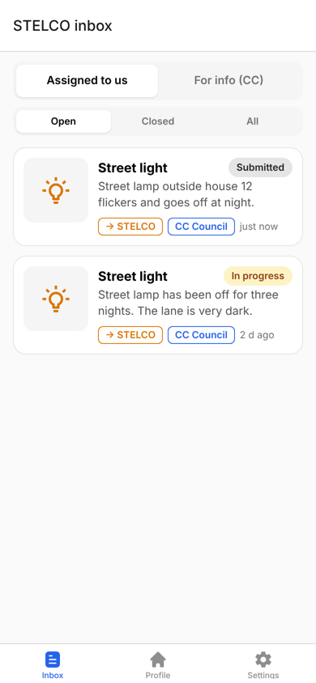 |

| Staff status update | Timeline after update | Settings |
|---|---|---|
| 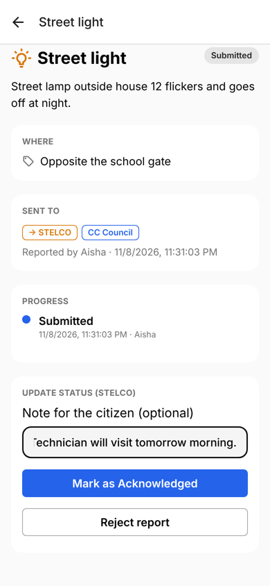 | 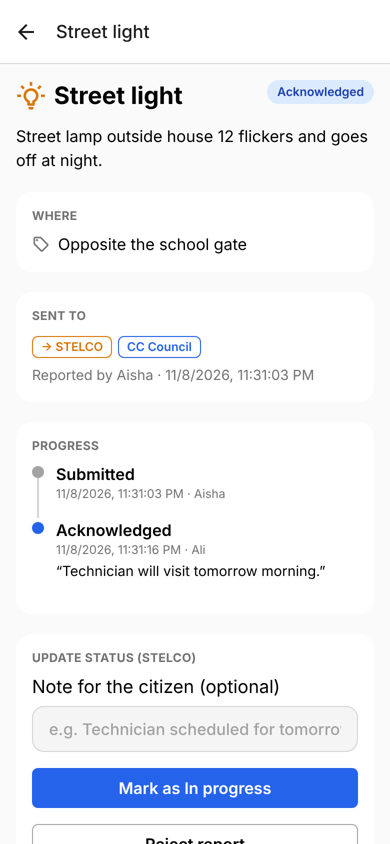 | 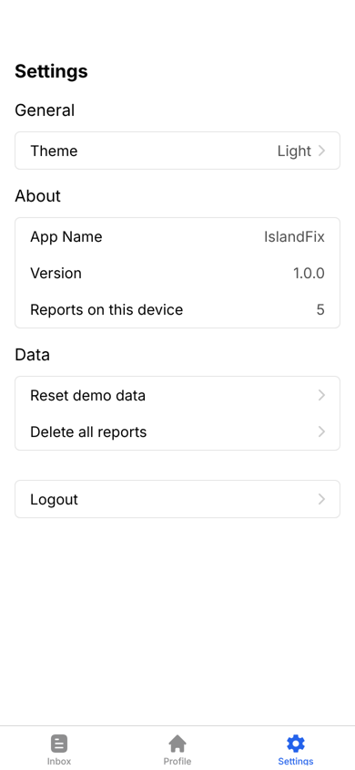 |

| Dark mode |
|---|
| 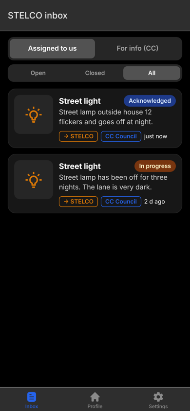 |

### Navigation flow
```
Onboarding (first launch only)
  -> Sign in
       -> Bottom tabs
            - Reports / Inbox -> Report details -> (staff) update status
                      |
                      +-> New report (modal) -> Report details
            - Profile -> Sign out -> Sign in
            - Settings (theme, reset data, delete all reports, sign out)
```
Navigation uses **Expo Router** (file-based routing): a root **stack**, a
**tab** navigator for signed-in users, a **modal** for the new report form, and
redirect guards that send users to onboarding or sign in when needed.

---

## Technologies Used

| Area | Technology |
|---|---|
| Framework | React Native 0.79, Expo SDK 53, TypeScript |
| Navigation | Expo Router 5 (stack, tabs, modal) |
| State management | MobX and mobx-react-lite (stores in `src/stores`) |
| Persistence | mobx-persist-store with AsyncStorage; expo-file-system for photos |
| Forms and validation | React Hook Form and Zod |
| Styling | NativeWind (Tailwind CSS for React Native), light and dark themes |
| Icons | @expo/vector-icons (MaterialCommunityIcons) |
| Device features | expo-image-picker (camera and gallery), expo-location (GPS) |
| Public API | OpenStreetMap Nominatim reverse geocoding (no API key) |
| Feedback messages | react-native-flash-message |
| Testing | Jest with jest-expo |
| Starter template | [RN-ExpoGo-Villa-Sample](https://github.com/Yasir5247/RN-ExpoGo-Villa-Sample) |

---

## Project Structure

```
assets/                        App icon, adaptive icon, splash screen, favicon
src/
  app/                         Screens (file-based routing)
    _layout.tsx                Root stack; loads saved data before showing the app
    (auth)/onboarding.tsx      First-launch introduction
    (auth)/login.tsx           Email and password sign in
    (app)/_layout.tsx          Bottom tabs and sign-in guards
    (app)/index.tsx            Reports list (citizen) / inbox (staff)
    (app)/profile.tsx          User details and report counts
    (app)/settings.tsx         Theme, data options, sign out
    report/new.tsx             New report form (modal)
    report/[id].tsx            Report details, timeline, staff actions
  components/
    login-form.tsx             Sign-in form and demo account list
    reports/                   Report card, badges, category icon, segmented control, empty state
    ui/                        Base UI kit from the template, plus AppIcon
  lib/reports/
    types.ts                   Report, user, agency and status types
    config.ts                  Agencies, categories, routing rules, status labels, icons
    logic.ts                   Pure business logic (routing, permissions, filtering)
    demo-users.ts              Demo accounts and the authenticate() check
    geocode.ts                 Nominatim API call with error handling
    media.ts                   Camera, gallery and GPS helpers
    __tests__/                 Unit tests
  stores/
    auth-store.ts              Signed-in user and role (persisted)
    reports-store.ts           All reports (persisted)
    seed-reports.ts            Sample reports for first launch
    ui-theme-store.ts          Light, dark or system theme (persisted)
    __tests__/                 Store tests
```

---

## Testing and Debugging

### Automated tests
`yarn test` runs **32 unit tests** with Jest:
- **Routing rules:** each category goes to the correct lead and copied agencies.
- **Status workflow:** allowed and blocked status changes.
- **Permissions:** only lead agency staff can update a report; citizens can
  only withdraw their own untouched reports.
- **Lists:** filtering by user, agency and status, and sorting by date.
- **Sign in:** correct and wrong passwords, unknown emails, email case, and
  that the password is never returned.
- **Reports store:** adding, updating, removing and resetting reports.

### Error handling
- Inline validation messages on the sign-in and new report forms.
- Friendly messages when camera, photo or location permission is denied.
- The address lookup has a timeout and separate messages for no internet,
  server errors and "no address found"; the report still saves.
- Confirmation dialogs before rejecting, withdrawing or deleting reports.

### Bugs found and fixed during development
| Problem | Cause | Fix |
|---|---|---|
| The list filter tabs (Community, Closed, All, For info) crashed on Android with "Couldn't find a navigation context", although they worked on the web | NativeWind cannot add classes such as `shadow-sm` or `dark:` to a component after it has rendered | The selected tab style is now set with the `style` prop instead of changing classes |
| After restarting in dark mode, the header was dark but screens, cards and text stayed light | The template restored the navigation theme from storage but did not apply it to NativeWind | The saved theme is applied to NativeWind when the theme store loads |
| A template icon component referenced a function that did not exist (`isRTL`) | Bug in the starter template | Replaced with React Native's `I18nManager.isRTL` |
| Package version warnings on startup | Starter template packages did not match Expo SDK 53 | Aligned with `npx expo install --fix` |

### Devices tested
Android (Samsung, Expo Go SDK 53), iOS Simulator and web browser.

---

## Known Issues and Future Improvements

- **Data stays on one device:** there is no backend, so reports are not shared
  between phones. Roles are demonstrated by signing out and in on the same
  device. A future version will use **Supabase** (database, authentication and
  photo storage) with the current local storage kept as an offline cache that
  syncs when the connection returns.
- **Demo authentication only:** accounts are defined in the app and passwords
  are not encrypted. Real accounts would be checked on a server.
- **No push notifications** when a report's status changes.
- **No in-app map:** reports have an "Open in Maps" link, but a map of nearby
  reports would help agency staff.
- **English only:** the language option was hidden for this version. A Dhivehi
  translation (right-to-left) is planned.
- **Agency web dashboard:** staff would realistically use a desktop dashboard;
  this is planned alongside the Supabase backend.
- Nominatim is a free community service with usage limits; a production app
  would use its own geocoding provider.
- The custom app icon is only visible in a standalone build, not inside Expo Go.

---

## Reflection

*(Write this section in your own words: what went well, what was difficult,
what you learned about React Native, Expo and debugging on real devices, and
what you would do differently. Link it to the findings from your user testing
report.)*

---

## Credits

- Starter template: [RN-ExpoGo-Villa-Sample](https://github.com/Yasir5247/RN-ExpoGo-Villa-Sample)
- Address data: OpenStreetMap contributors, via the Nominatim API
- Icons: MaterialCommunityIcons via @expo/vector-icons
